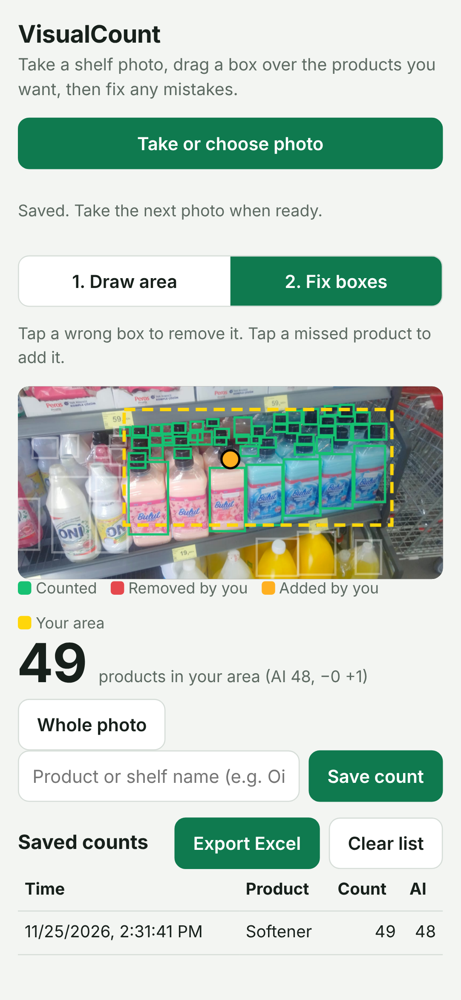
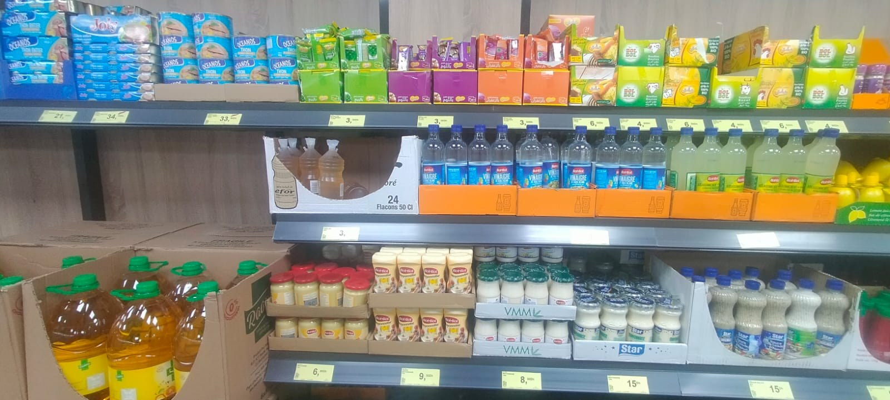
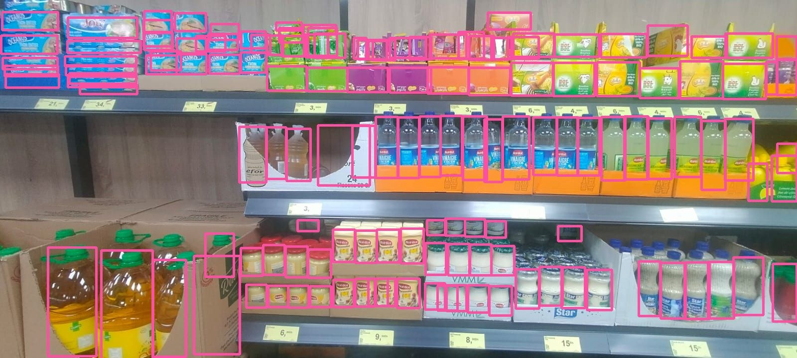
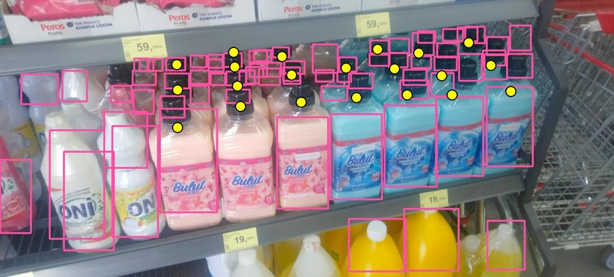
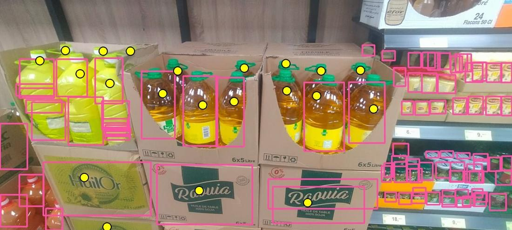

# VisualCount

**Comptez les produits d'un rayon avec une simple photo prise au téléphone.**

VisualCount aide les commerçants (supérettes, supermarchés, dépôts) à compter leur stock plus vite :
on prend une photo du rayon, on entoure la zone voulue avec le doigt, et l'application donne le nombre de produits.
On peut corriger le résultat en un geste, puis exporter tous les comptages vers Excel.

> ⚠️ **Version 1, encore en test.** Elle fonctionne bien sur les cartons, paquets et petites bouteilles.
> Les grosses bouteilles et bidons sont parfois comptés deux fois (voir [Limites](#limites-connues)).

<p align="center">
  
</p>

## Comment ça marche

L'intelligence artificielle tourne sur **l'ordinateur du magasin**. Le téléphone ouvre simplement une page web
sur le même Wi-Fi. **Aucune photo ne sort du magasin**, et rien n'est envoyé sur Internet.

```
 Téléphone (photo)  ──Wi-Fi──>  Ordinateur du magasin (IA)  ──>  nombre de produits + Excel
```

## Mode d'emploi en 5 étapes

### 1. Prendre la photo
Appuyez sur **« Take or choose photo »** et photographiez le rayon, bien de face, sans trop d'angle.
L'ordinateur repère chaque produit visible en 1 à 3 secondes.

<p align="center"></p>

### 2. Entourer la zone à compter
Dans **« 1. Draw area »**, faites glisser votre doigt sur la partie du rayon qui vous intéresse
(par exemple un seul produit). Seuls les produits **à l'intérieur du cadre jaune** sont comptés.
Le bouton **« Whole photo »** compte toute la photo.

Voici ce que l'IA détecte sur la photo ci-dessus (un cadre = un produit) :

<p align="center"></p>

### 3. Corriger les erreurs
Dans **« 2. Fix boxes »** :
- touchez un cadre **faux** pour l'enlever (il devient rouge) ;
- touchez un produit **oublié** pour l'ajouter (point orange).

Le total se met à jour tout de suite, par exemple *« 49 products in your area (AI 48, −0 +1) »*.

### 4. Enregistrer
Tapez un nom (par exemple « Huile 5L ») et appuyez sur **« Save count »**.

### 5. Exporter vers Excel
**« Export Excel »** télécharge un fichier avec tous les comptages : heure, produit, total final,
total de l'IA, et les corrections faites à la main.

## Installation (une seule fois, environ 10 minutes)

1. Installez **Python 3.11 ou plus récent** depuis https://www.python.org/downloads/
   - Sous Windows, cochez **« Add python.exe to PATH »** sur le premier écran de l'installateur.
2. Téléchargez ce projet (bouton vert **Code > Download ZIP**) et décompressez-le, par exemple sur le Bureau.

## Démarrer l'application

- **Windows :** double-cliquez sur `app/start-windows.bat`
- **Mac :** double-cliquez sur `app/start-mac.command` (si macOS bloque : clic droit > Ouvrir > Ouvrir)

Le premier démarrage installe les bibliothèques et télécharge le modèle d'IA (environ 170 Mo) :
comptez quelques minutes. Ensuite, le démarrage prend environ 15 secondes.

Quand c'est prêt, la fenêtre affiche deux adresses :

```
On this computer:  http://localhost:8000
On your phone:     http://192.168.1.23:8000   (same Wi-Fi)
```

Tapez l'adresse « On your phone » dans le navigateur du téléphone (Chrome, Safari…).
Laissez la fenêtre ouverte pendant l'utilisation. Si le téléphone n'arrive pas à se connecter,
autorisez Python dans le pare-feu de l'ordinateur quand Windows le demande.

> N'ouvrez pas `app/static/index.html` directement : passez toujours par `start-windows.bat`
> puis par l'adresse `http://...:8000`, sinon le comptage reste à 0.

Pour essayer sans aller au magasin, utilisez les photos du dossier [`samples/`](samples/).

## Limites connues

- **Grosses bouteilles et bidons :** le bouchon et la bouteille peuvent recevoir chacun un cadre,
  donc le produit est compté deux fois. Enlevez les cadres en trop à l'étape 3.
  Exemple ci-dessous : les points jaunes sont les vrais produits, les cadres roses ce que voit l'IA.

<p align="center"></p>

- Les produits très cachés ou dans le fond du rayon peuvent être oubliés.
- L'application compte **tous les produits ensemble** ; elle ne reconnaît pas encore les marques.

## Comment le modèle a été choisi

55 photos de vrais rayons ont servi à comparer 4 modèles d'IA (résultats dans [`model-test/`](model-test/)) :

| Modèle | Résultat |
|---|---|
| **DETR entraîné sur SKU-110K (rayons de magasins)** | ✅ Le meilleur, environ 1,2 s par photo sur un PC sans carte graphique |
| RF-DETR (COCO) | Ne trouve presque que les bouteilles |
| Grounding DINO | Compte beaucoup trop peu |
| OWLv2 | Compte trop, avec beaucoup de faux cadres |

<p align="center"></p>

## Prochaines étapes

1. Tester l'application avec de vrais commerçants.
2. Reconnaître **chaque produit** (marque, format) à partir de quelques photos de référence.
3. Construire une carte numérique des rayons du magasin.

Vous tenez un commerce et le comptage du stock vous prend des heures ? **Contactez-moi**, je cherche des testeurs.

## Licence

- **Code :** licence MIT (voir [`LICENSE`](LICENSE)).
- **Photos** (`samples/`, `docs/images/`) : © l'auteur, fournies uniquement pour illustrer et tester l'application.
- **Modèle d'IA :** [`is36e/detr-resnet-50-sku110k`](https://huggingface.co/is36e/detr-resnet-50-sku110k), téléchargé
  automatiquement au démarrage, non inclus dans ce dépôt. Il a été entraîné sur le jeu de données
  [SKU-110K](https://github.com/eg4000/SKU110K_CVPR19), réservé à un usage **académique et non commercial**.
  Une version commerciale utilisera un modèle ré-entraîné sur nos propres photos.

---

*English: VisualCount counts products on a shop shelf from a phone photo. The AI runs locally on the shop's PC;
the phone connects over Wi-Fi. Setup and usage in English: [`app/README-en.md`](app/README-en.md).*
